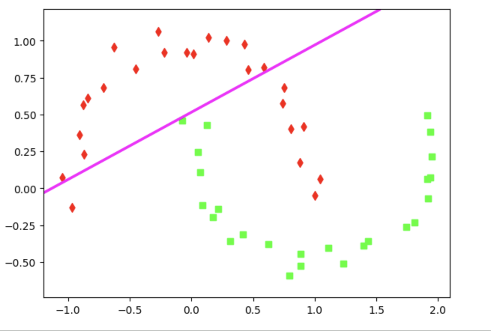
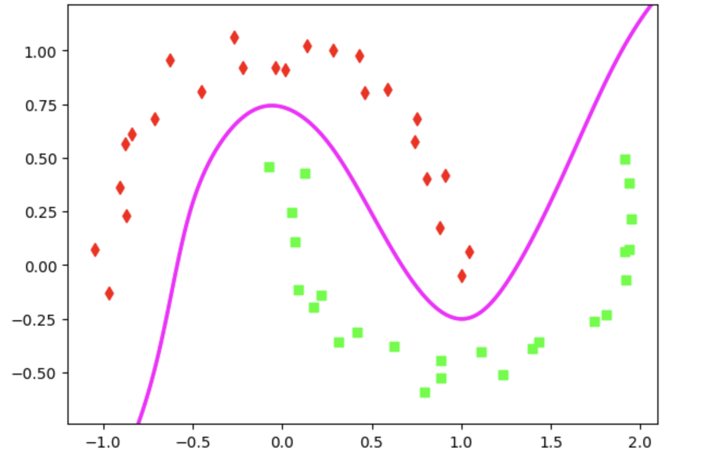
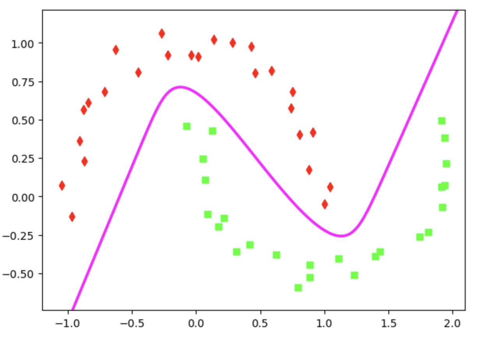
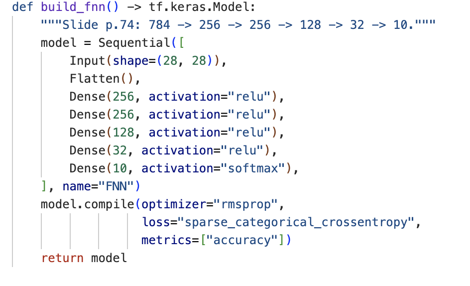
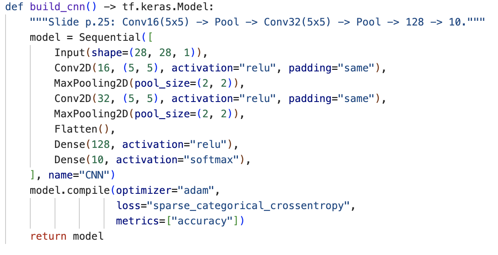
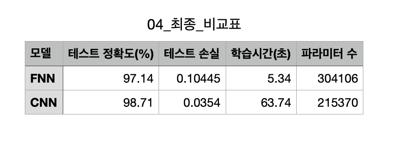
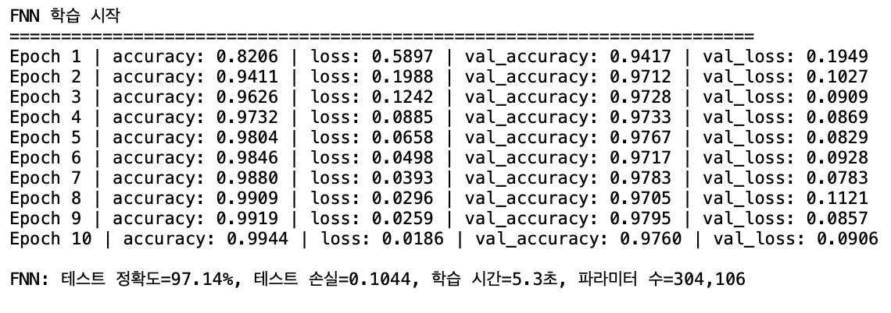
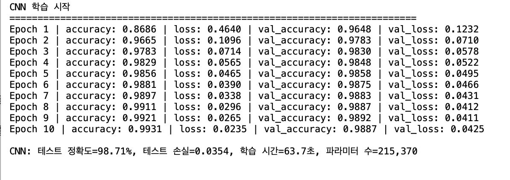
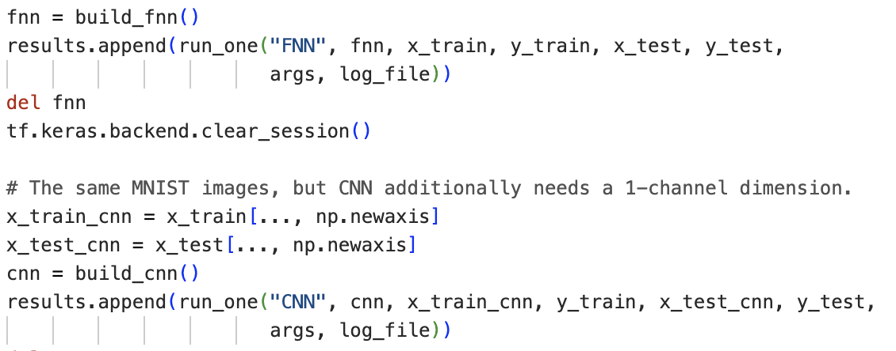
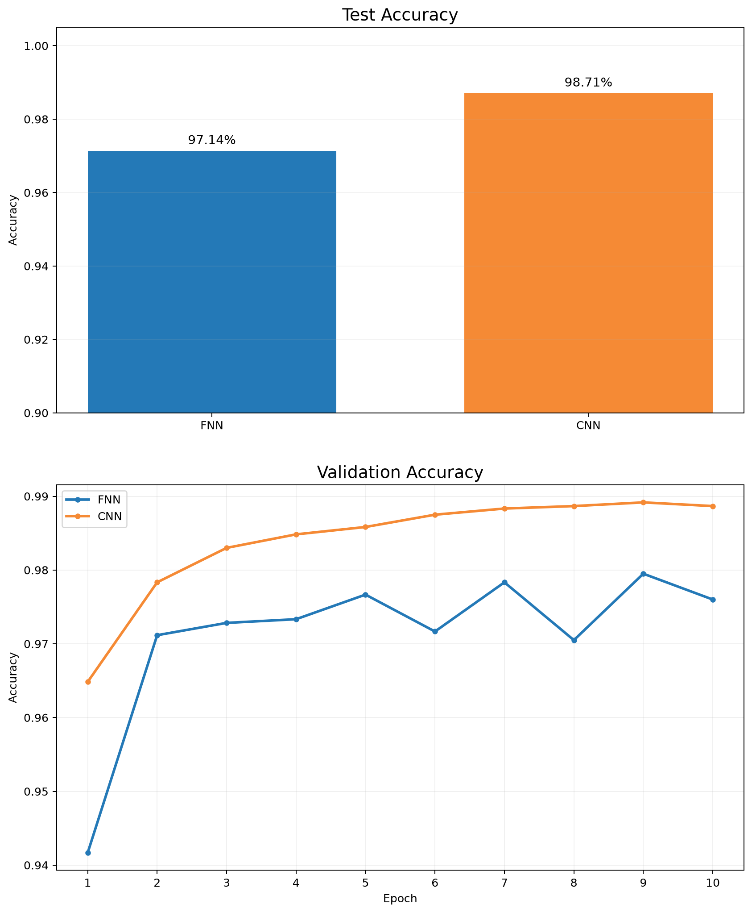

# CV2026
### Homework1
[yolo test video](https://youtu.be/b-2xvB9VPXQ)
 
[selfie test video](https://youtu.be/Zf_-dgLY3Vo)

### Homework2

### 입력층 2개, 첫 번째 은닉층 2개, 두 번째 은닉층 2개, 출력층 1개

<a href="homework/SLOC01_HW1_2-2-1.ipynb">Classification_homework 코드</a>
 

### 입력층 2개, 첫 번째 은닉층 5개, 두 번째 은닉층 5개, 출력층 1개

<a href="homework/SLOC01_HW1_5-5-1.ipynb">Classification_homework 코드</a>
 

### 입력층 2개, 첫 번째 은닉층 10개, 두 번째 은닉층 10개, 출력층 1개

<a href="homework/SLOC01_HW1_10-10-1.ipynb">Classification_homework 코드</a>

### Homework3 

# ANN(FNN) vs CNN 비교 분석

## 1. FNN 모델 구성

## 2. CNN 모델 구성

## 3. FNN 및 CNN 실행 코드

## 4. FNN 학습 결과

## 5. CNN 학습 결과

## 6. 최종 성능 비교

## 7. 정확도 비교 그래프

